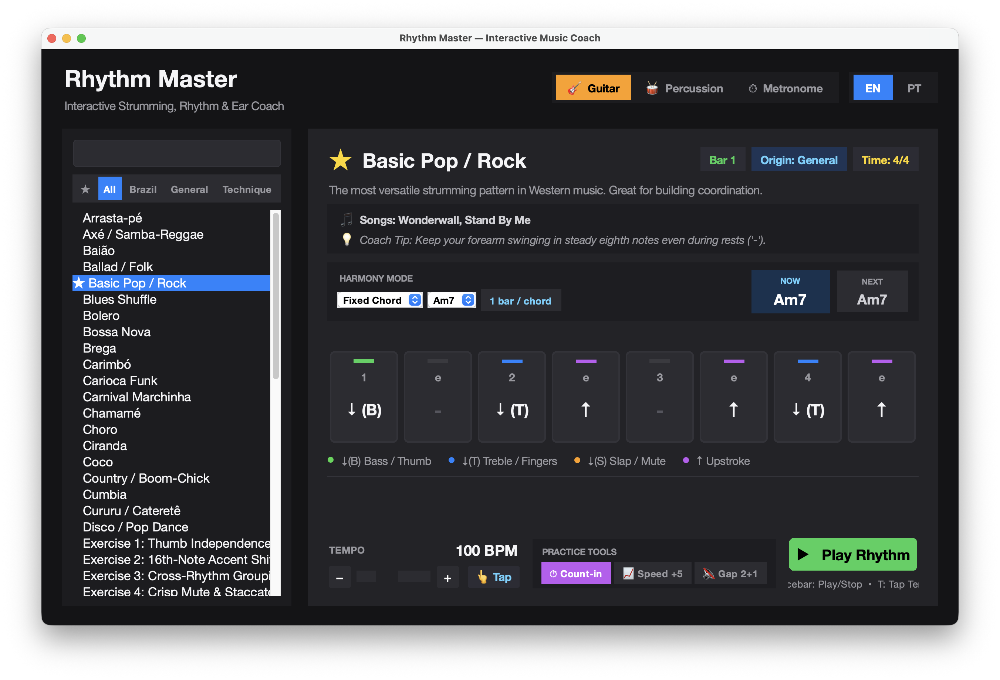

# Rhythm Master — Interactive Strumming & Rhythm Trainer for macOS

**Rhythm Master** is a desktop application to help guitarists and musicians practice strumming patterns, subdivisions, and rhythmic grooves—featuring a comprehensive library of **Brazilian rhythms** alongside essential international styles.

---

## Features

- **Multiple Harmony Modes:**
  - **Fixed Chord:** Freely choose any chord from the catalog to practice individual bars.
  - **Major & Minor Progressions:** Select the harmonic field (tonic key) and structural format (e.g., *I - V - vi - IV* or *i - VI - III - VII*) automatically generated for you.
  - **Music Genres:** Instantly switch between characteristic progressions for Pop/Rock, Bossa Nova, Samba, Baião, and Blues.
- **Real-Time Karplus-Strong Synthesizer:** Acoustic guitar simulation powered by physical string modeling (featuring separated bass, treble, upstrokes, and muted slaps) alongside integrated percussion sounds.
- **Flexible Harmonic Duration:** Easily toggle between **1 bar** or **2 bars** per chord (*ideal for fast rhythms like Baião and Frevo*).
- **Tap Tempo Engine:** Automatically detect tempo (BPM) in real time by clicking the dedicated button or pressing the `T` key.
- **Advanced Practice Modes:**
  - **Count-in:** A 1-bar preparation count-in before playback begins.
  - **Speed Trainer:** Automatically increases tempo by +5 BPM every 4 bars for speed training.
  - **Gap Click:** Mutes 1 out of every 3 bars to test the musician's internal clock.

---

## Project Structure

    ├── main.py            # Main GUI, audio synthesizer engine, and precision metronome loop
    ├── practice_data.py   # Data for practice options
    ├── rhythms_db.py      # Bilingual database of general and Brazilian rhythmic patterns
    ├── setup.py           # py2app configuration for macOS .app bundling
    ├── requirements.txt   # Packaging and macOS Cocoa framework dependencies
    ├── Makefile           # Automation for setup, running, building, and installing
    └── README.md

---

## Requirements

- **macOS** (Apple Silicon or Intel)
- **Python 3.10+** (with Tcl/Tk support; via Homebrew: `brew install python-tk@3.14`)

---

## Quick Start

Using the included `Makefile`:

1. **Set up the virtual environment and install dependencies:**

       make setup

2. **Run the application in development mode:**

       make run

3. **Build the standalone macOS `.app` bundle:**

       make build

   The compiled app will be generated at `dist/Rhythm Master.app`.

4. **Install directly into `/Applications`:**

       make install

5. **Clean build artifacts or virtual environment:**

       make clean-build   # Removes build/ and dist/
       make clean         # Removes build/, dist/, venv/, and __pycache__/

---

## Keyboard Shortcuts & Controls

- **`Spacebar`:** Start / Stop playback.
- **`−` / `+` or Slider:** Adjust tempo between `40` and `200 BPM` in real time.
- **Top Bar Switches:** Toggle seamlessly between **Guitar / Percussion / Metronome** and **EN / PT** without interrupting playback.

---

## How the Guitar Synthesis Works

Instead of bundling static `.wav` or `.mp3` assets, `MacNativeAudioEngine` generates all acoustic guitar strokes on startup using the **Karplus-Strong string synthesis algorithm**:

- Each string is initialized with a zero-mean filtered noise burst and passed through a low-pass delay-line feedback loop.
- Downstrokes (`↓(B)`, `↓(T)`) and upstrokes (`↑`) mix multiple chord frequencies with realistic millisecond strum offsets.
- Percussive slaps (`↓(S)`) combine rapidly damped strings with a low-frequency wooden body resonance.

---

## License

MIT License — feel free to use, modify, and share.